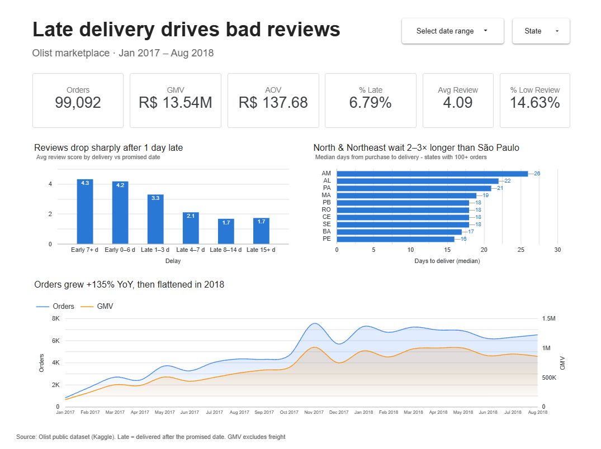
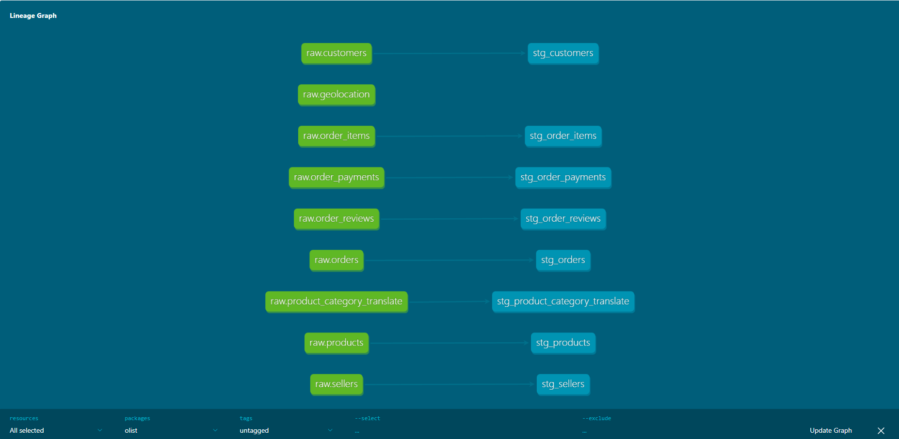

# Olist E-commerce Operations & Data Model

> **Business question:** What drives bad customer reviews on a Brazilian marketplace — and where should operations act first?
> Secondary: where does revenue come from (categories, sellers, states), and do customers come back?

**Scope:** ~99k orders, 9 tables, Sep 2016 – Oct 2018 (analysis window Jan 2017 – Aug 2018) · DuckDB + dbt star schema · Data Studio (formerly Looker Studio)

**▶ [Live dashboard](https://datastudio.google.com/s/vIDl5xbSNE0)**



## TL;DR

| # | Finding | Evidence |
|---|---|---|
| 1 | **Late delivery is the #1 driver of bad reviews — and costs repeat business** | Late orders score **2.27** vs **4.29** on time. Only **6.7%** of orders are late, but they produce **32.6%** of all 1–2★ reviews. The later, the worse: 1–3 days late → 3.29, 8–14 days → 1.67. Months with late spikes (Nov 2017, Feb–Mar 2018) show the lowest scores (monthly corr −0.84). Customers whose **first order was late** come back **1.62%** vs **2.25%** |
| 2 | **Lateness is a geography problem, not a few bad sellers** | 64% of GMV ships from São Paulo sellers. Median delivery: SP 7 days vs AM 26, AL 22, PA 21. Sellers with ≥15% late rate cause only **5.7%** of late orders |
| 3 | **Growth came from volume, not basket size — and is flattening** | Jan–Aug 2018 vs 2017: orders **+135%**, GMV **+137%**, AOV flat at ~R$137. 2018 GMV plateaus at R$0.85–1.0M / month |
| 4 | **Almost no repeat customers** | Repeat rate **2.24%** (distinct purchase days; 3.12% by orders — 30% of "second orders" are same-day split checkouts). Median 28 days to 2nd order |
| 5 | **Revenue is concentrated** | Top 20% of sellers = **82.6%** of GMV (top 1% = 25.7%). Top 5 of 74 categories = 39.8%. Office furniture: 19-day median delivery, 3.65★ |

## Recommendations

| Priority | Action | KPI | Based on |
|---|---|---|---|
| 1 | Regional fulfilment / carrier SLA for North & Northeast; start with **RJ** (2nd-largest volume, 12% late) | % late, 1–2★ share | Findings 1, 2 |
| 2 | Proactive "your order may be late" notification + make estimates honest per state | 1–2★ share on late orders | Finding 1 (score drops even at 1–3 days late) |
| 3 | Post-purchase retention campaign at 2–4 weeks, measured against a holdout group | Repeat rate (distinct days) | Finding 4 |
| 4 | Basket-size levers: bundles, free-shipping threshold; key-account program for top sellers | AOV, top-seller retention | Findings 3, 5 |

## Data Issues Found

| Issue | Evidence | Decision |
|---|---|---|
| `customer_id` is generated **per order** | 99,441 ids = 99,441 orders; 96,096 `customer_unique_id` | All customer metrics on `customer_unique_id` |
| Payments ≠ items + freight | 99.69% match; 303 orders differ | Revenue from `order_items`; payments only for payment mix |
| Multiple reviews per order; `review_id` not unique | 547 orders, 202 with conflicting scores | Keep latest review per order; key = (review_id, order_id) |
| 775 orders without items | 603 unavailable, 164 canceled | Excluded from revenue, kept in status funnel |
| Carrier date out of order | 1,359 before approval, 166 before purchase | Not used in delivery KPIs |
| Sparse edge months | 2016: 329 orders (Nov missing); Sep–Oct 2018: 20 | Trends use Jan 2017 – Aug 2018 |
| Geolocation not one row per zip | 52.6 rows / zip, 261,831 exact duplicates | Not modeled; geography at state level |

Full log: 15 decisions with evidence and impact (`sql/01_quality_checks/`).

**dbt lineage** (raw → staging):



## Approach

```
CSV (9) ──► DuckDB raw (all VARCHAR) ──► quality checks (SQL, read-only)
                                     └─► dbt staging (types, dedup, rules) ──► dbt marts (star schema) ──► analysis SQL ──► Looker Studio
```

| Layer | Tool | What |
|---|---|---|
| Ingest | DuckDB · `sql/00_ingest` | 9 CSVs → schema `raw`, row counts reconciled with source |
| Quality | SQL · `sql/01_quality_checks` | Grain & keys, orphans, reconciliation, dates, coverage — 7 files |
| Transform | dbt-duckdb · `olist_dbt/` | 8 staging views → 2 facts + 4 dimensions (tables) |
| Tests | dbt | 92 tests: unique, not_null, relationships, accepted_values + revenue / order-count reconciliation |
| Analysis | SQL · `sql/02_analysis` | 6 question files |
| Export | SQL · `sql/03_export` | 2 flat, dashboard-ready CSVs (orders, order items) |
| Dashboard | Data Studio | 1 page: KPIs, delay → review, delivery by state, monthly trend — [live link](https://datastudio.google.com/s/vIDl5xbSNE0) |

**Data model** (details: [`docs/data_model.md`](docs/data_model.md)):

| Table | Grain |
|---|---|
| `fct_orders` | one order — items, payments and latest review pre-aggregated (no fan-out) |
| `fct_order_items` | one item in an order — category / seller revenue |
| `dim_customers` | one real customer (`customer_unique_id`) |
| `dim_products` · `dim_sellers` · `dim_date` | one product · one seller · one day (2016–2018) |

**Method notes**
- GMV = `SUM(price)` (excludes freight). Late = delivered date > estimated date (date level). Review score NULL when no review (never 0).
- Delivery and review metrics by category / seller use distinct (order, category / seller) pairs to avoid double counting.
- Median used for delivery time (right-skewed, max 210 days).

## Limitations
- Late delivery ↔ review / repeat is an **association**, not proven causation; only reviewed orders (99.2%) are analysed. Repeat comparison is right-censored (late-window customers had less time to return).
- "Late" is measured against Olist's estimate, which is padded (median estimate 24 days vs 10 actual).
- Payment differences attributed to installment interest is an assumption.
- Anonymised public data from one marketplace, 2016–2018.

## How to Reproduce

1. Download the dataset from Kaggle (`olistbr/brazilian-ecommerce`) into `data/raw/`.
2. Load raw tables: run `sql/00_ingest/01_load_raw.sql` in DuckDB (edit the absolute path to your folder).
3. Build and test the models:
   ```bash
   uv sync
   cd olist_dbt
   uv run dbt build        # 92 tests
   uv run dbt docs generate && uv run dbt docs serve
   ```
4. Run the analysis files in `sql/02_analysis/` against `olist.duckdb`.
5. Run `sql/03_export/01_export_looker.sql` and upload the two CSVs to Data Studio (CSV File Upload connector).

> DuckDB is pinned to 2.0.0 to match the DBeaver driver. Close other connections to `olist.duckdb` before running dbt (single writer).

## Structure

```
├── data/raw/                 # source CSVs (gitignored)
├── sql/
│   ├── 00_ingest/            # load raw
│   ├── 01_quality_checks/    # 7 read-only checks
│   ├── 02_analysis/          # 6 business questions
│   └── 03_export/            # dashboard CSV export
├── olist_dbt/
│   ├── models/staging/       # 8 stg_ views + sources + tests
│   ├── models/intermediate/  # order-grain aggregates (ephemeral)
│   ├── models/marts/         # fct_ / dim_ tables + tests
│   └── tests/                # reconciliation tests
├── docs/data_model.md        # star schema, grain, metric definitions
├── reports/dashboard.png     # dashboard screenshot
└── pyproject.toml            # dbt-duckdb, duckdb 2.0.0
```

## Citation
Olist. *Brazilian E-Commerce Public Dataset by Olist.* Kaggle. https://www.kaggle.com/datasets/olistbr/brazilian-ecommerce (CC BY-NC-SA 4.0)
