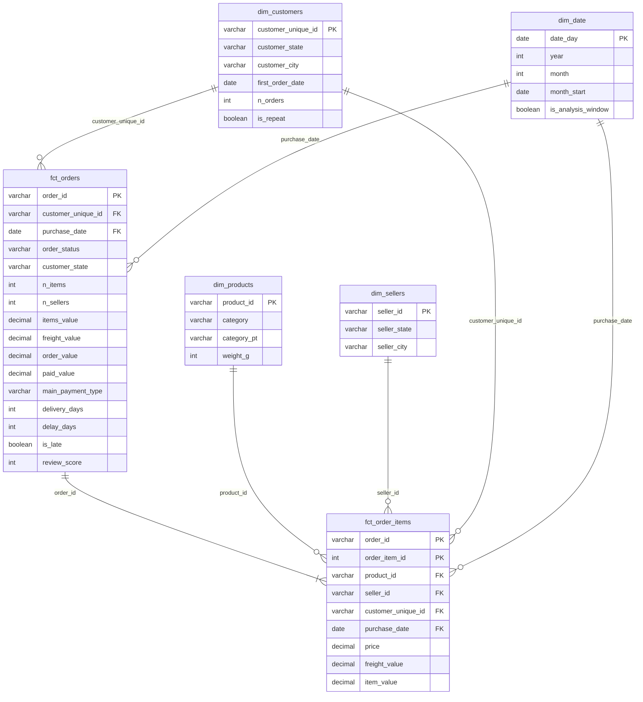

# Data Model — Olist Star Schema

Two facts at different grains + four conformed dimensions. Built in dbt (`olist_dbt/models/marts`).

## Grain

| Table | Grain | Key |
|---|---|---|
| fct_order_items | one item in one order | (order_id, order_item_id) |
| fct_orders | one order | order_id |
| dim_customers | one real customer | customer_unique_id |
| dim_products | one product | product_id |
| dim_sellers | one seller | seller_id |
| dim_date | one calendar day, 2016-01-01 → 2018-12-31 | date_day |

## Design decisions

| Decision | Why |
|---|---|
| Two facts (items + orders) | Category / seller revenue needs item grain; delivery, review and payment KPIs live at order grain. One fact would force fan-out. |
| Payments and reviews folded into `fct_orders` | Aggregated to one row per order before joining (no fan-out). Latest review per order. |
| `customer_unique_id` as customer key | `customer_id` is generated per order (Data Quality Decision 1). |
| `customer_state` kept on `fct_orders` | 39 customers ordered from more than one state; delivery is analysed by the state the order shipped to. |
| `seller_id` only on items | 1,278 orders contain items from more than one seller. |
| Category translation folded into `dim_products` | Star, not snowflake: one join from fact to dimension. |
| No geolocation dimension | Not one row per zip (52.6 rows / zip); state level is complete. |

## Metric definitions

| Metric | Definition |
|---|---|
| GMV | SUM(price) — excludes freight |
| Order value | SUM(price + freight_value) per order |
| Delivery days | purchase → delivered to customer, delivered orders only |
| Late | delivered date > estimated date (date level) |
| Review score | latest review per order; NULL if none |
| Repeat customer | customer_unique_id with ≥ 2 orders |
| Analysis window | purchases 2017-01-01 → 2018-08-31 |